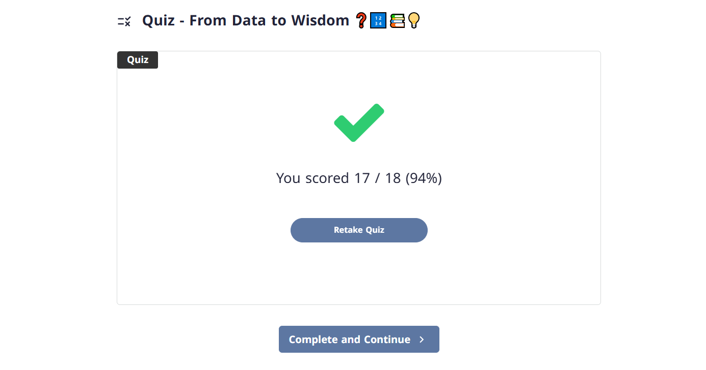

# Data vs Information vs Knowledge vs Wisdom (DIKW)

## Data vs Information
* **Data:** Raw, unprocessed facts and figures with no structure or meaning on their own (e.g., 100 years of raw temperature readings).
* **Information:** Structured, analyzed, and meaningful data that answers "what is happening?" (e.g., global temperature rose by 1.2°C over the past century).
* **Core Formula:** Data + Meaning = Information.

## Data Processing Model (IPO)
* **Input:** Raw data enters the system.
* **Processing:** Sorting, grouping, and analyzing the data.
* **Output:** Meaningful information (e.g., regional sales numbers processed into a sales report).

## The DIKW Hierarchy
* **Data:** Collected facts — answers "where to start?"
* **Information:** Organized, meaningful data — answers "what?"
* **Knowledge:** Understood and internalized information — answers "why?"
* **Wisdom:** Judgment and real-world application for better decisions — answers "what should we do?"

## Key Takeaway
Each level builds upon the previous one (`Data -> Information -> Knowledge -> Wisdom`), turning raw facts into insight and actionable decisions.