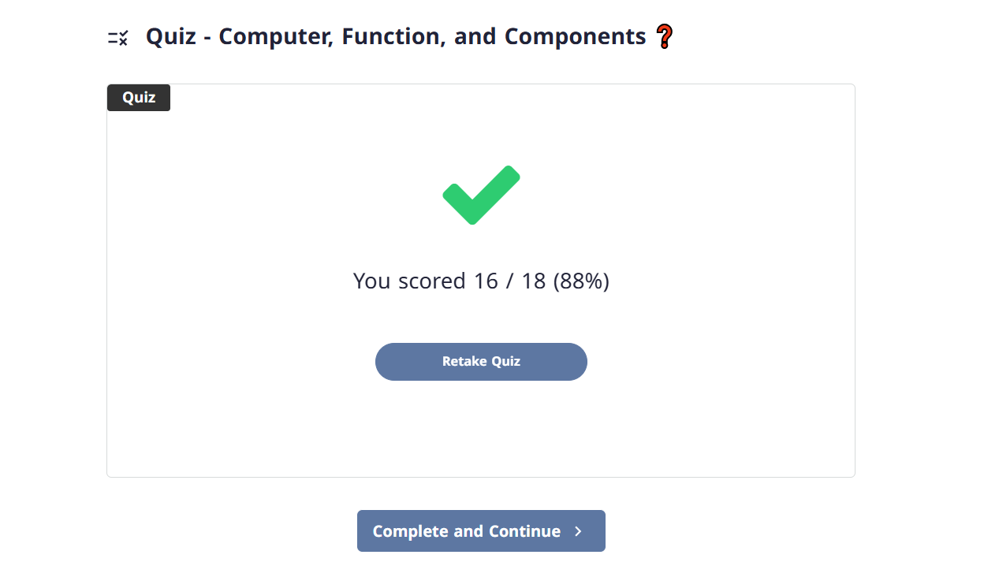

# Computer Speeds & Units (Bits, Bytes, Hz, and Architectures)

## Bits, Bytes & Memory Units
* **Bit & Byte:** Bit is the smallest unit (`0` or `1`), and 1 Byte = 8 bits.
* **Binary Scaling (Base 2):** 1 KB = 1,024 B, 1 MB = 1,024 KB, 1 GB = 1,024 MB, 1 TB = 1,024 GB (followed by PB, EB, ZB, YB with real-world scale examples).
* **Note:** This lesson follows the binary (2^10 = 1,024) convention rather than decimal (10^3) labels used in some storage/OS contexts.

## Memory Hierarchy & Access Speed
Proximity to the CPU determines access speed (fastest to slowest):
1. **Registers:** Inside the CPU for instant instruction data.
2. **Cache:** On-chip fast access to recently used data/instructions.
3. **Main Memory (RAM):** Fast, but slower than cache.
4. **Secondary Storage (SSD/HDD):** Slowest of these tiers, used for long-term storage.

## CPU Speed & Hertz (Hz)
* **Clock Speed:** Measured in Hertz (cycles per second); e.g., `3.2 GHz` = 3.2 billion cycles/sec.
* **Transistors:** Act as binary switches (`OFF`/`ON` → `0`/`1`) opening and closing each cycle to execute instructions.