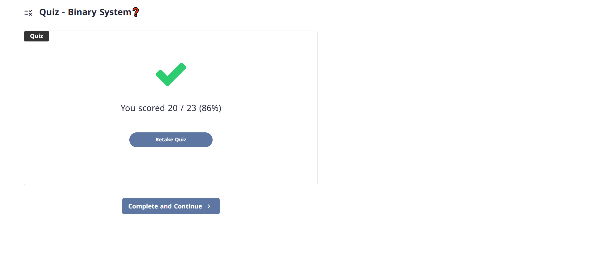
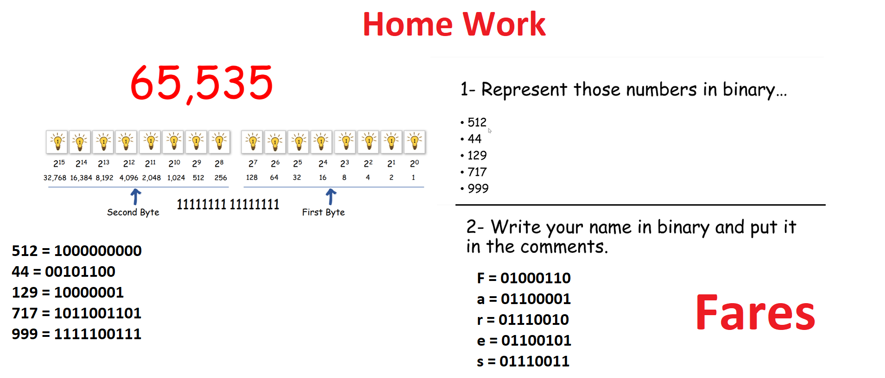

# Understanding the Binary System in Computers

## How Computers & Binary Work
* **Electrical States:** Computers rely on transistors acting as microscopic binary switches (`ON` = `1`, `OFF` = `0`) inside the CPU.
* **Base-2 System:** Uses only `0` and `1`, where each position represents a power of two (`1, 2, 4, 8, 16, 32, 64, 128...`); e.g., `13` = `00001101` (`8 + 4 + 1`).
* **Unique Representation:** Every non-negative integer has a single unique binary representation (ignoring leading zeros), unlike decimal sums with multiple combinations.

## Bits, Bytes & Conversions
* **Bit & Byte:** A bit is a single binary digit (`0` or `1`); a byte is 8 bits (`128 64 32 16 8 4 2 1`).
* **Decimal to Binary:** Repeatedly divide by `2` and read remainders from bottom to top (e.g., `20` -> `10100`).
* **Binary to Decimal:** Sum the positional values of bits set to `1` (e.g., `00010100` -> `16 + 4 = 20`).
* **Byte Capacity:** 1 byte (8 bits) maxes out at `255`, 2 bytes (16 bits) at `65,535`, and 64-bit values scale up to `18,446,744,073,709,551,615` total sum across 64 positions.

## Text Encoding: ASCII vs. Unicode
* **ASCII:** Maps English characters and basic symbols to binary codes (e.g., `'A'` = `65` = `01000001`, Space = `32`), but is limited to English/basic sets (128 or 256 codes).
* **Unicode:** Universal standard supporting all world languages (including Arabic text like `محمد`) across encodings such as UTF-8, UTF-16, and UTF-32.