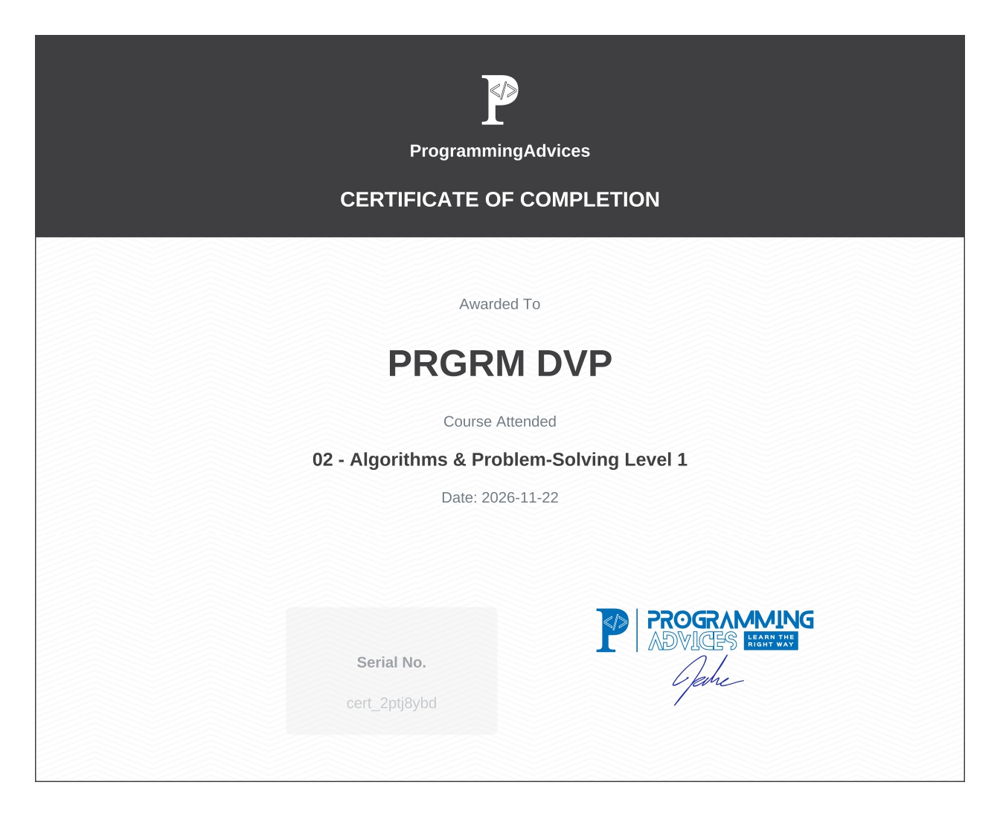

# 02 - Algorithms & Problem-Solving Level 1

## Overview
In this course, I focused purely on **algorithmic thinking and problem-solving using flowcharts** without writing a single line of programming code. I worked through the flowcharts **by hand using pen and paper**, tracing every step, variable state, and branch manually to build a strong mental model of problem logic before moving into programming syntax.

## Core Concepts Covered
* **50 Hand-Solved Problems:** Solved and traced **50 algorithm problems** manually on paper with a pen, translating each problem statement into clear step-by-step flowchart logic.
* **Pen-and-Paper Flowcharting:** Drawing and tracing flowcharts by hand on paper with a pen to map out step-by-step logic, inputs, processing, and outputs without relying on code or screen shortcuts.
* **Programming Logic & Control Flow:** Understanding sequential execution, decision-making (`if` conditions), and repetition/loops (`while` / `for` logic) visually through flowcharts.
* **Relational Operators:** Comparing values using greater than (`>`), less than (`<`), greater than or equal (`>=`), less than or equal (`<=`), equal to (`==`), and not equal to (`!=`).
* **Logical Operators:** Combining and evaluating multiple conditions using `AND` (`&&`) and `OR` (`||`) logic to handle complex decision rules accurately.
* **Problem Decomposition & Dry Running:** Breaking problems down into clear steps and manually dry-running edge cases on paper to catch logic errors early.

## Certificate
* **Course:** 02 - Algorithms & Problem-Solving Level 1
* **Completion Date:** 2026-11-22
* **Serial No.:** `cert_2ptj8ybd`
* **Note:** Enrolled under the alias `PRGRM DVP` (verified via Serial No. `cert_2ptj8ybd`).
* **Official PDF:** [Download Certificate (PDF)](./certificate.pdf)

