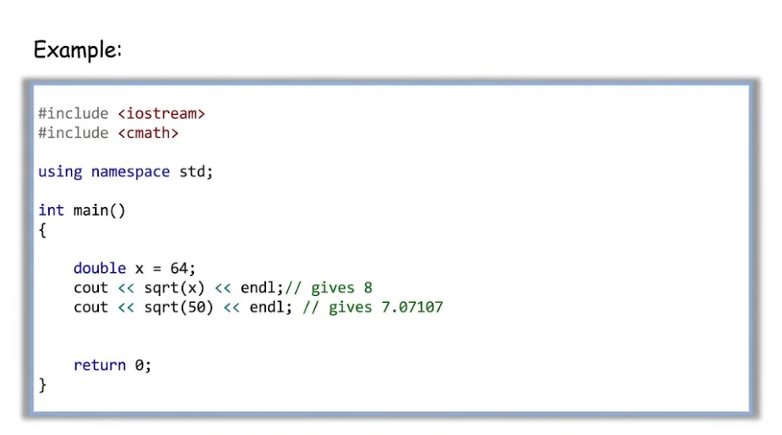
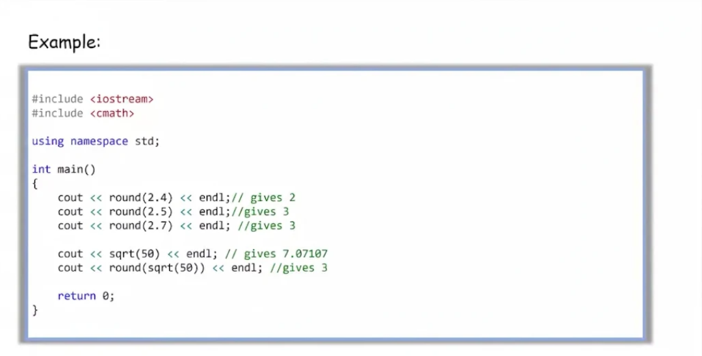
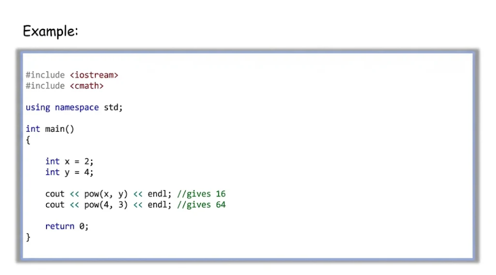

# 13 Math Functions (`<cmath>`)

## Lesson Overview
Examples demonstrating common C++ math functions from the `<cmath>` library:
- `sqrt()` — Square root
- `round()` — Round to the nearest integer
- `pow()` — Raise a number to a power
- `ceil()` & `floor()` — Round up or down to the nearest integer
- `abs()` — Absolute value

## Lesson Slides

## Source Code
- [main.cpp](./main.cpp)