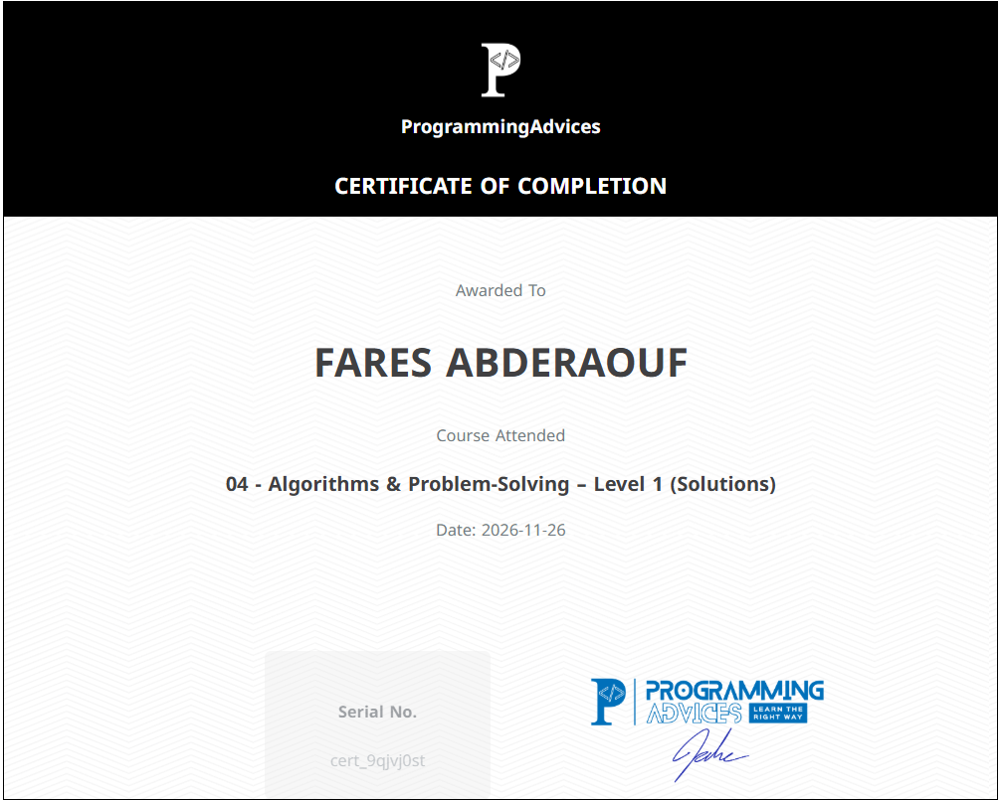

# Course 04 — Algorithms & Problem-Solving (Clean Code & Divide and Conquer)

A complete revisit of all 50 problems from Level 1 with a focus on **Clean Code** and **Divide and Conquer**—moving beyond just getting the right output to writing structured, maintainable code.

## Course Highlights
* Transitioning from "code that works" to clean, controlled, and readable logic
* Breaking problems into clear sub-problems while avoiding long functions and duplication
* Using functions as reusable building blocks to reduce complexity
* Establishing a strong foundation for upcoming clean code and software engineering courses
* Updated profile identity by replacing the alias and adding my real name for professional documentation

## Certificate
* PDF version: [Certificate PDF](certificate.pdf)
* Image version: 